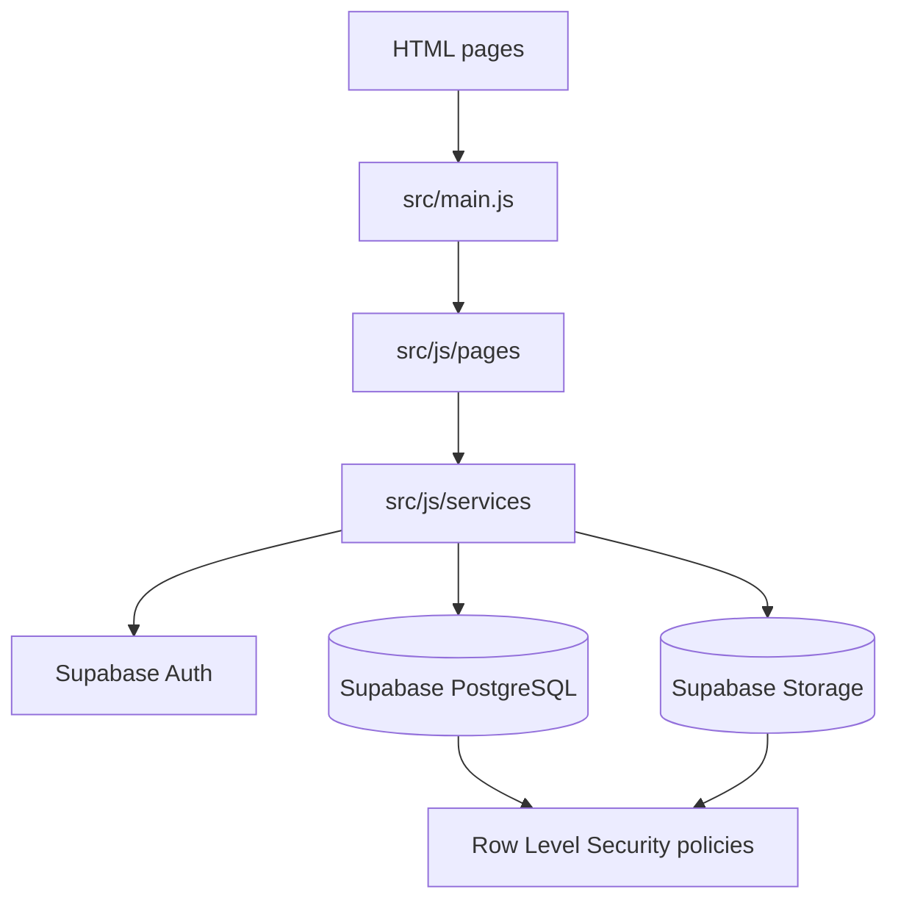

# Pawly — Pet Care Assistant

> **Everything your pet needs, in one thoughtful place.**

Pawly is a friendly pet-care assistant that helps owners keep their pets'
profiles, photos, and health information organised. It combines a personal
pet dashboard with digital pet records, useful care articles, and creative
tools for celebrating everyday moments.

The project is a lightweight multi-page frontend built with vanilla
JavaScript and Supabase. It is designed to make important pet information
easy to update, find, and share while keeping each user's data isolated.

[](https://developer.mozilla.org/en-US/docs/Web/JavaScript)
[](https://vite.dev/)
[](https://getbootstrap.com/)
[](https://supabase.com/)

## Contents

- [Features](#features)
- [Screenshots](#screenshots)
- [Technology stack](#technology-stack)
- [Architecture](#architecture)
- [Database](#database)
- [Installation and setup](#installation-and-setup)
- [Demo and access](#demo-and-access)
- [Security](#security)
- [Project structure](#project-structure)
- [Development context](#development-context)
- [Roadmap](#roadmap)
- [Author](#author)

## Features

### Implemented

- **Authentication and accounts** — register, sign in, sign out, and update
  basic profile information with Supabase Auth.
- **Personal dashboard** — see a summary of registered pets, health records,
  and recently added care information after signing in.
- **Pet profiles and CRUD** — create, view, edit, and delete profiles with
  name, species, breed, sex, birth date, weight, and notes.
- **Digital pet passports** — keep a dedicated, shareable-style view of a
  pet's identity and key details; Pawly Moments also includes a passport
  creative template.
- **Health records** — add, edit, and remove vaccination, check-up,
  treatment, test, deworming, and other records.
- **Pet photo uploads** — upload supported JPEG, PNG, or WebP photos for a
  pet. Photos are kept in private Supabase Storage and served through signed
  URLs.
- **Pawly Moments** — create a downloadable canvas collage from one to three
  local photos using templates such as Polaroid, birthday, passport,
  then-and-now, cover, and adventure.
- **Pet-care articles** — browse published articles and their cover images
  for practical pet-care tips.
- **Administrator panel** — authorised administrators can create, edit,
  publish, and delete articles.
- **Public interactive demo** — explore the product experience with
  fictional, read-only sample data without creating an account.
- **Responsive interface** — Bootstrap 5 layout utilities and Pawly-specific
  CSS provide a mobile-friendly experience across the application.

### Planned

The following are intentionally not presented as completed functionality:

- A deployed production URL and hosted environment.
- Dedicated architecture, database, and ER-diagram documents.
- Additional pet-care workflows beyond the current profile, records,
  articles, and creative tools.

## Screenshots

The repository does not currently contain committed screenshots. The
following placeholders mark the views that should be captured for a future
portfolio presentation:

| View | Screenshot |
| --- | --- |
| Homepage | *Screenshot placeholder — add a homepage capture* |
| Dashboard | *Screenshot placeholder — add a signed-in dashboard capture* |
| My Pets | *Screenshot placeholder — add the pet list capture* |
| Digital Pet Passport | *Screenshot placeholder — add a pet details/passport capture* |
| Pawly Moments | *Screenshot placeholder — add the collage creator capture* |
| Public Demo | *Screenshot placeholder — add the interactive demo capture* |

## Technology stack

| Technology | Purpose |
| --- | --- |
| HTML5 | Multi-page application markup and semantic structure |
| CSS3 | Responsive styling and Pawly-specific visual design |
| Vanilla JavaScript (ES modules) | Application logic, rendering, and browser interactions |
| Bootstrap 5 | Layout utilities, responsive components, and form styling |
| Vite | Development server and production bundling |
| Supabase Auth | User registration, sessions, and authentication |
| Supabase PostgreSQL | Relational application data |
| Supabase Storage | Private pet photos and article cover images |
| Supabase Row Level Security | Database and Storage access isolation |

Bootstrap Icons are also used for interface icons.

## Architecture

Pawly uses a browser-first, multi-page architecture. Each HTML entry page
loads the shared `src/main.js` entry point, which renders shared navigation
and dispatches page-specific behaviour to the relevant module in
`src/js/pages/`.



### Data flow

1. A page module initialises inside the existing `#app` element.
2. Protected pages require an authenticated Supabase session before rendering
   private content.
3. Service modules issue typed-by-convention Supabase queries for pets, health
   records, articles, roles, and Storage objects.
4. PostgreSQL and Storage policies enforce ownership and administrator
   permissions server-side; the frontend is not the security boundary.
5. Returned data is escaped or sanitised before being inserted into rendered
   HTML.

The repository currently has no `docs/` directory, so
`docs/ARCHITECTURE.md` and `docs/DATABASE.md` are not linked here as broken
references. The migration files and this section are the current
architecture documentation. A complete ER diagram is also not currently
committed; the migration files below are the authoritative schema source.

Related setup documentation:

- [First administrator setup](supabase/ADMIN_SETUP.md)
- [Article Storage setup](supabase/ARTICLE_STORAGE_SETUP.md)
- [Supabase migrations](supabase/migrations/)

## Database

Supabase manages `auth.users`; Pawly owns the application tables in the
`public` schema:

| Table | Purpose | Relationships |
| --- | --- | --- |
| `auth.users` | Supabase-managed user accounts | Referenced by roles, pets, and article authors |
| `public.user_roles` | User role assignments (`user` or `admin`) | One role row per `auth.users` record |
| `public.pets` | Pet identity and profile information | Belongs to one authenticated user |
| `public.health_records` | Health events and notes | Belongs to a user and references `public.pets` |
| `public.articles` | Published and draft pet-care content | References the authenticated author |

Pets and health records are linked by `pets.id` → `health_records.pet_id`.
Deleting a user cascades to their pets and health records. Articles retain
their author relationship and protect the author from being changed.

Row Level Security is enabled for the application tables. Users can access
their own roles, pets, and health records; published articles are readable
publicly; article management is restricted to administrators. The
`pet-photos` Storage bucket is private and checks both the authenticated user
and pet ownership. Article cover access follows publication and administrator
permissions.

The schema is implemented in:

- [Pets migration](supabase/migrations/20261105130000_create_pets.sql)
- [Pet photo Storage policies](supabase/migrations/20261105150500_create_pet_photos_storage.sql)
- [Health records migration](supabase/migrations/20261106210000_create_health_records.sql)
- [Roles and articles migration](supabase/migrations/20261107213000_create_roles_and_articles.sql)
- [Article cover image policies](supabase/migrations/20261107220000_add_article_cover_images.sql)

## Installation and setup

### Prerequisites

- Node.js with npm
- A Supabase project for authenticated and data-backed features

### 1. Clone the repository

```bash
git clone https://github.com/darina-raycheva/Pawly-app.git
cd Pawly-app
```

### 2. Install dependencies

```bash
npm install
```

### 3. Configure Supabase

Copy `.env.example` to `.env` and set the two Vite variables for your own
Supabase project:

```dotenv
VITE_SUPABASE_URL=your-supabase-project-url
VITE_SUPABASE_PUBLISHABLE_KEY=your-supabase-publishable-key
```

Do not commit `.env`, real credentials, service-role keys, or other secrets.
Apply the SQL migrations from `supabase/migrations/` to configure the
database, RLS policies, and Storage policies. Follow the
[administrator setup guide](supabase/ADMIN_SETUP.md) when assigning the
first administrator.

### 4. Start the development server

```bash
npm run dev
```

Open the local URL printed by Vite, usually `http://localhost:5173`.

### 5. Build and preview production output

```bash
npm run build
npm run preview
```

The available npm scripts are defined in [`package.json`](package.json).

## Demo and access

Open `demo.html` in the Vite development server to explore the public
interactive demo. It uses fictional, in-browser sample data and is
intentionally read-only: it does not represent a signed-in account, does
not persist user changes, and does not provide access to Supabase data.

The full experience is available through the other pages after Supabase
configuration and account registration. No demo credentials are required or
provided.

> **Production URL:** *To be added after a Netlify deployment is created.*

## Security

- **Authentication:** Supabase Auth manages registration, sessions, and
  authenticated user identity.
- **Data isolation:** PostgreSQL Row Level Security limits pets and health
  records to their owner and protects role and article operations.
- **Administrator permissions:** the `user_roles` table and the
  `is_admin()` database function gate article administration; the first
  administrator is assigned manually through Supabase.
- **Private photos:** pet photos are stored in a private bucket and accessed
  through ownership-checked signed URLs. Article cover policies distinguish
  published content from administrator operations.
- **Output protection:** user-controlled values are HTML-escaped before
  rendering, and article content is sanitised before it is displayed.

These are implementation details documented from the current source and
migrations; Pawly has not been independently security audited.

## Project structure

```text
Pawly-app/
├── .env.example
├── admin.html
├── article.html
├── dashboard.html
├── demo.html
├── health-record.html
├── index.html
├── login.html
├── moments.html
├── pet-details.html
├── pets.html
├── profile.html
├── register.html
├── package.json
├── package-lock.json
├── vite.config.js
├── src/
│   ├── main.js
│   ├── style.css
│   ├── assets/
│   └── js/
│       ├── demo-data.js
│       ├── pages/
│       ├── services/
│       └── utils/
└── supabase/
    ├── ADMIN_SETUP.md
    ├── ARTICLE_STORAGE_SETUP.md
    └── migrations/
```

## Development context

Pawly was developed as a **SoftUni course project** with AI-assisted
development tools used to support implementation, iteration, and
documentation. GitHub Copilot was used appropriately as a development
assistant; the project structure, application decisions, and final code
remain part of the project's source and review process.

## Roadmap

- [ ] Add a Netlify production deployment and link it here.
- [ ] Add curated screenshots to the repository.
- [ ] Add dedicated architecture and database documentation.
- [ ] Add a complete database ER diagram.
- [ ] Extend the pet-care experience with additional practical workflows.

## Author

Created by [Darina Raycheva](https://github.com/darina-raycheva).

Project repository: [darina-raycheva/Pawly-app](https://github.com/darina-raycheva/Pawly-app)
