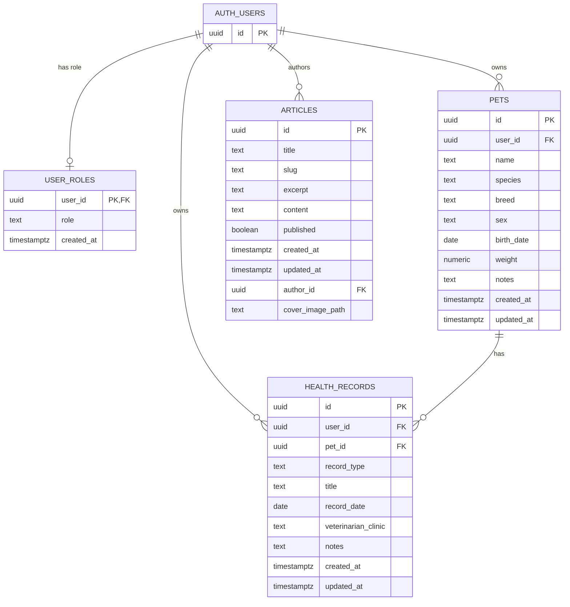

# Pawly Database

The diagram below reflects the relationships declared in the SQL migrations.
`auth.users` is managed by Supabase Auth; only the referenced `id` column is
shown because the application migrations do not define the Auth table.

## Migration-derived schema

### `auth.users`

Managed by Supabase Auth. The application migrations reference
`auth.users(id)` but do not define its other columns.

### `public.user_roles`

Defined in `20261107213000_create_roles_and_articles.sql`:

- `user_id uuid primary key references auth.users(id) on delete cascade`
- `role text not null default 'user'`
- `created_at timestamptz not null`

The role is constrained to `admin` or `user`. Accounts without a role row
are treated as non-admin by the frontend and database checks.

### `public.pets`

Defined in `20261105130000_create_pets.sql`:

- `id uuid primary key`
- `user_id uuid not null references auth.users(id) on delete cascade`
- `name text not null`
- `species text not null`
- `breed text`
- `sex text`
- `birth_date date`
- `weight numeric(7, 2)`
- `notes text`
- `created_at timestamptz not null`
- `updated_at timestamptz not null`

### `public.health_records`

Defined in `20261106210000_create_health_records.sql`:

- `id uuid primary key`
- `user_id uuid not null references auth.users(id) on delete cascade`
- `pet_id uuid not null references public.pets(id) on delete cascade`
- `record_type text not null`
- `title text not null`
- `record_date date not null`
- `veterinarian_clinic text`
- `notes text`
- `created_at timestamptz not null`
- `updated_at timestamptz not null`

### `public.articles`

Defined in `20261107213000_create_roles_and_articles.sql` and extended in
`20261107220000_add_article_cover_images.sql`:

- `id uuid primary key`
- `title text not null`
- `slug text not null unique`
- `excerpt text not null`
- `content text not null`
- `published boolean not null default false`
- `created_at timestamptz not null`
- `updated_at timestamptz not null`
- `author_id uuid not null references auth.users(id) on delete restrict`
- `cover_image_path text` (nullable)

## Row Level Security

The migrations enable RLS and define ownership policies for pets and health
records. Role rows are readable only by the authenticated owner. Public
readers can access published articles, while article writes require
`public.is_admin()`. Storage policies separately protect pet photos and
article covers.
